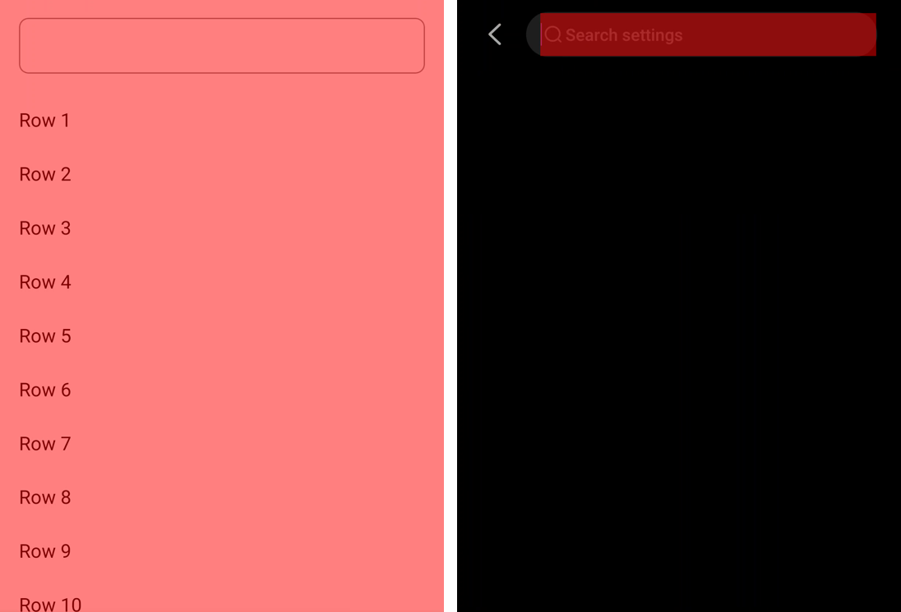

# A caret blink repaints the whole React root on Android

[react/react-native#59534](https://github.com/react/react-native/issues/59534)

React Native 0.88.0, from the [React Native reproducer template](https://github.com/react-native-community/reproducer-react-native). `App.tsx` focuses a `TextInput` above a list, so the blinking caret is the only thing on screen that changes.

## Steps

On a phone: the emulator repaints its whole window for every app, Android's Settings included, so it shows no difference.

1. Build and install the release APK: `cd ReproducerApp/android && ./gradlew assembleRelease && adb install -r app/build/outputs/apk/release/app-release.apk`.
2. Open the app and leave it untouched while the caret blinks.
3. Record six seconds of frames with this repository's `caret.pbtxt`: `adb shell perfetto -c - --txt -o /data/misc/perfetto-traces/caret.pftrace < caret.pbtxt`, then `adb pull /data/misc/perfetto-traces/caret.pftrace` and open it in https://ui.perfetto.dev.
4. On the app's `RenderThread`, each frame's `Drawing <left> <top> <right> <bottom>` slice is the rectangle that frame repainted.
5. Open Android's Settings search, whose field is focused when it opens (`adb shell am start -a com.android.settings.action.SETTINGS_SEARCH`), and record the same.

On a RedMagic NX809J (Android 16), every caret frame here repainted `0 0 1216 2688`, the whole window the React root fills, on 12 of 12 frames. Settings search repainted its field, `228 146 1148 263`, on 10 of 12.

With Developer options › Show GPU view updates on, each blink flashes the whole screen here and only the search field in Settings. One blink of each on the RedMagic, status bar and keyboard cropped, Settings' search history blacked out:

## What it costs

On a Snapdragon phone the frame after the caret's 500 ms pause also waits for the GPU to wake from idle, so the whole-root repaint lands on a slow GPU. Release RNTester, built from [#59230](https://github.com/react/react-native/pull/59230)'s branch, whose one change is to RNTester's legacy native view example, with its Components search field focused, against Settings search, on a Galaxy S23 (SM-S911B), Android 14, HWUI on GL; each window is 12 s with `dumpsys gfxinfo <package> framestats`, counting the blinks after ~475 ms with no frame:

| | Repainted per blink frame | GPU done after the swap | Missed 16.67 ms |
| --- | --- | --- | --- |
| RNTester | `0 81 1080 2295`, the React root, on 24 of 24 | 4.7–18.0 ms, median 16.1 | 24 of 25 |
| Settings search | `156 181 822 268`, the field, or `0 81 1080 321`, the search bar | 6.8–12.1 ms | 0 of 12 |

The frame tables are [`readings/rntester-s23-framestats.txt`](readings/rntester-s23-framestats.txt) and [`readings/settings-s23-framestats.txt`](readings/settings-s23-framestats.txt).
